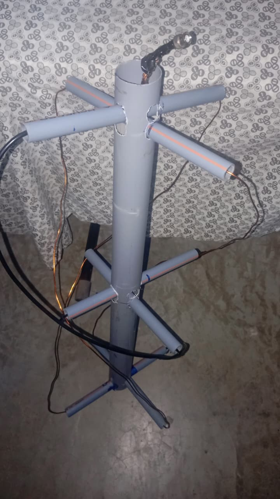
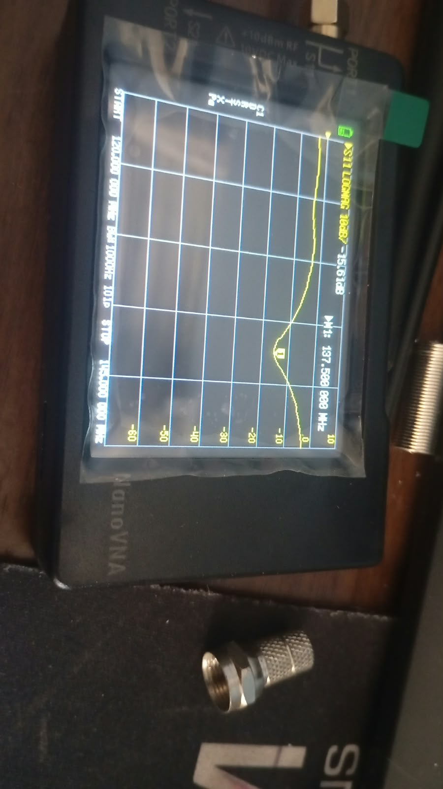
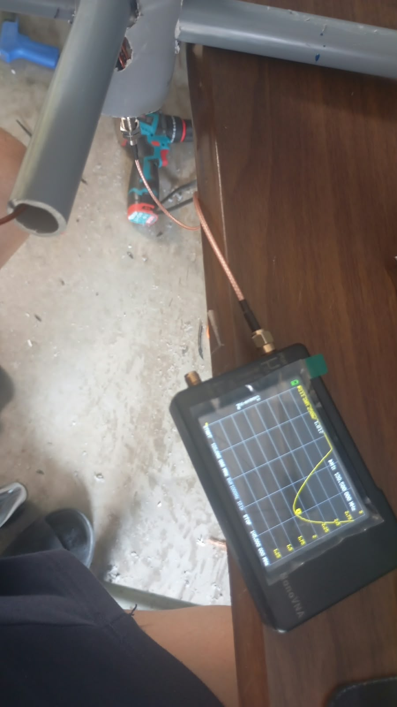
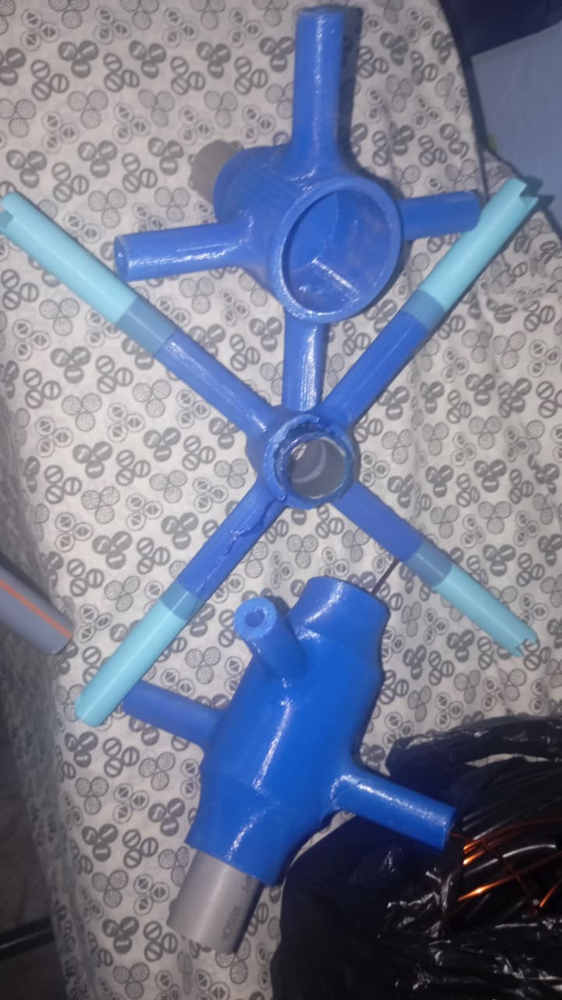

# Imágenes

Fotografías de la construcción y de las primeras mediciones.

| Archivo | Contenido |
|---|---|
| [1.jpeg](1.jpeg) | Antena construida físicamente. |
| [2.jpeg](2.jpeg) | Medición de S11 con VNA, con marcador en 137,5 MHz. |
| [3.jpeg](3.jpeg) | Medición de SWR con VNA. Consultar el marcador de la fotografía. |
| [4.jpeg](4.jpeg) | Soportes impresos en 3D con las dimensiones modificadas; pendientes de prueba. |

Modelo base de los soportes: [QFH Antenna 137.5 MHz](https://www.printables.com/model/973557-qfh-antenna-1375-mhz/files).

La medición de S11 se muestra en 137,5 MHz; los ajustes de simulación se hicieron alrededor de 137,9 MHz.

## 1. Antena construida

## 2. Medición de S11

## 3. Medición de SWR

## 4. Soportes impresos en 3D

